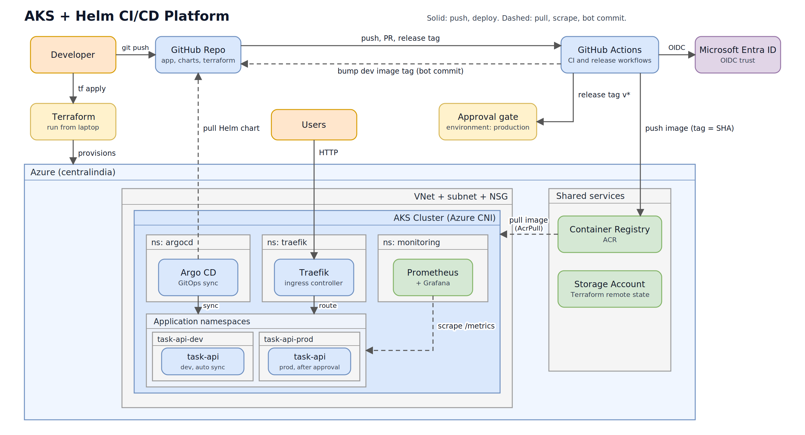
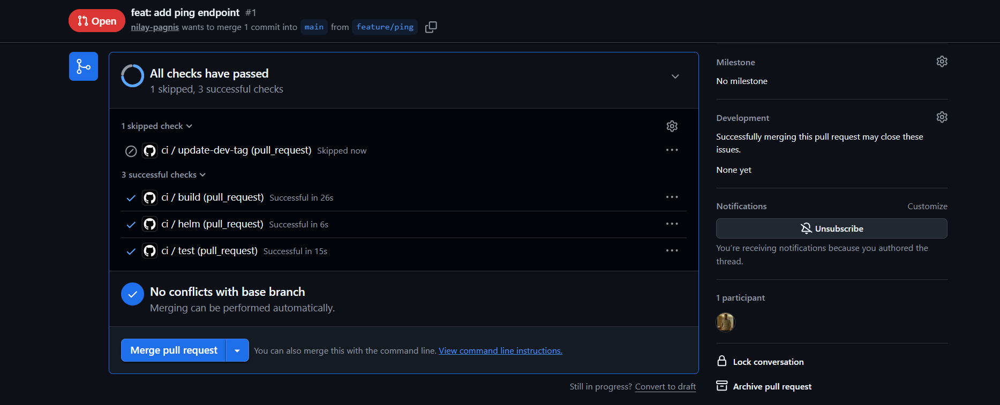
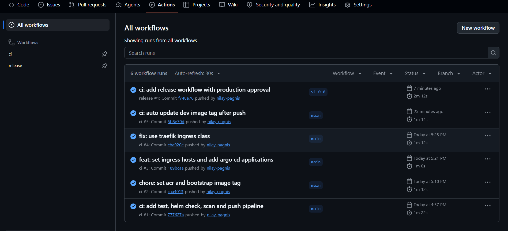
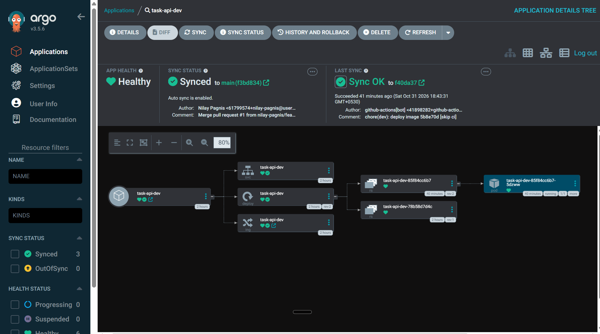
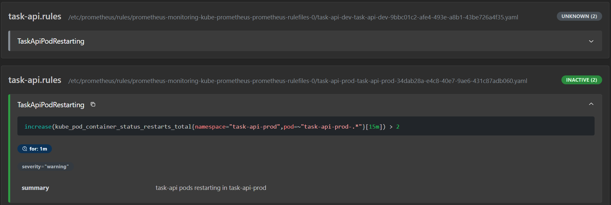
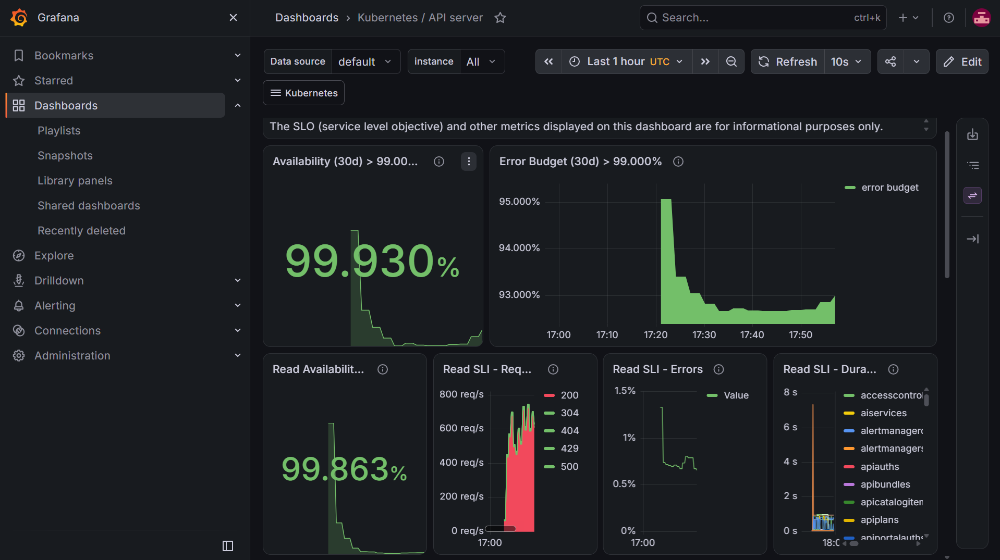

# AKS + Helm CI/CD Platform

A containerized Python API deployed to Azure Kubernetes Service (AKS) with a full CI/CD pipeline.
Infrastructure is built with Terraform, the app is packaged as a Helm chart, images are built and scanned by GitHub Actions, and deployments are handled by Argo CD (GitOps).



## What this project shows

- **Containerized app:** FastAPI service, multi-stage Docker build, non-root user, health and metrics endpoints
- **Helm chart:** one chart, two environments (`values-dev.yaml`, `values-prod.yaml`), probes, HPA (prod), hardened security context
- **Infrastructure as Code:** Terraform for VNet, subnet, NSG, AKS, ACR, and GitHub OIDC trust, with remote state in Azure Storage
- **CI pipeline:** lint, unit tests, Helm lint and render, Docker build, Trivy vulnerability scan, push to ACR
- **Passwordless auth:** GitHub Actions logs in to Azure with OIDC (no stored Azure secret)
- **GitOps CD:** Argo CD syncs the Helm chart from Git. A bot commit updates the dev image tag after every merge
- **Release flow:** a `v*` tag triggers a workflow that waits for manual approval (GitHub Environment), then promotes the same image to prod. No rebuild
- **Monitoring as code:** Prometheus and Grafana (kube-prometheus-stack), a ServiceMonitor and alert rules shipped inside the Helm chart

## How the pipeline works

| Event | What happens |
|---|---|
| Pull request | Ruff, pytest, `helm lint`, `helm template`, Docker build, Trivy scan. Nothing is pushed |
| Merge to `main` | Same checks, then image pushed to ACR (tag = commit SHA), then a bot updates `values-dev.yaml`. Argo CD deploys to dev automatically |
| Release tag `v*` | Workflow waits for approval in the `production` environment. After approval, the tag running in dev is verified in ACR and written to `values-prod.yaml`. Argo CD deploys to prod |

The image that was tested in dev is the image that goes to prod.

## Tech stack

| Area | Tools |
|---|---|
| Cloud | Azure (AKS, ACR, VNet, NSG, Entra ID) |
| IaC | Terraform |
| Packaging | Docker, Helm |
| CI/CD | GitHub Actions, Argo CD |
| Ingress | Traefik |
| Security | Trivy, OIDC federation, non-root containers, least-privilege roles (AcrPull, AcrPush) |
| Observability | Prometheus, Grafana, ServiceMonitor, PrometheusRule |
| App | Python, FastAPI, pytest, ruff |

## Repo structure

```
.
├── .github/workflows/
│   ├── ci.yml                # test, lint, scan, build, push, bump dev tag
│   └── release.yml           # approval gate and prod promotion
├── app/                      # FastAPI app, tests, Dockerfile
├── charts/task-api/          # Helm chart and per-environment values
├── argocd/                   # Argo CD Applications (dev, prod, traefik, monitoring)
├── terraform/                # AKS, ACR, network, GitHub OIDC
└── docs/                     # diagram and screenshots
```

## API

| Endpoint | Purpose |
|---|---|
| `GET /health` | Used by Kubernetes probes |
| `GET /version` | Returns the running image tag |
| `GET /ping` | Simple test endpoint |
| `POST /tasks`, `GET /tasks`, `GET /tasks/{id}` | Task API (in-memory storage) |
| `GET /metrics` | Prometheus metrics (`api_requests_total`) |

## Network plan

| Range | Use |
|---|---|
| 10.0.0.0/16 | VNet |
| 10.0.1.0/24 | AKS subnet |
| 10.1.0.0/16 | Kubernetes service CIDR (kept separate from the VNet to avoid overlap) |

The subnet NSG allows inbound TCP 80 and 443 from the internet and nothing else.

## How to run it

Prerequisites: Azure CLI, Terraform, kubectl, Helm, a GitHub account.

1. Create a storage account and a `tfstate` container for Terraform remote state.
2. In `terraform/`, create `backend.hcl` and `terraform.tfvars` (not committed).
3. Provision the infrastructure:

```bash
cd terraform
terraform init -backend-config=backend.hcl
terraform plan
terraform apply
```

4. Add repository secrets `AZURE_CLIENT_ID`, `AZURE_TENANT_ID`, `AZURE_SUBSCRIPTION_ID` and the variable `ACR_NAME` (from Terraform outputs).
5. Create a GitHub Environment named `production` with a required reviewer.
6. Get cluster credentials and install Argo CD:

```bash
az aks get-credentials -g rg-taskapi -n aks-taskapi
kubectl create namespace argocd
kubectl apply -n argocd --server-side --force-conflicts \
  -f https://raw.githubusercontent.com/argoproj/argo-cd/stable/manifests/install.yaml
```

7. Apply the Argo CD applications (install monitoring before the chart enables ServiceMonitor):

```bash
kubectl apply -f argocd/traefik.yaml
kubectl apply -f argocd/monitoring.yaml
kubectl apply -f argocd/task-api-dev.yaml
kubectl apply -f argocd/task-api-prod.yaml
```

8. Set the ingress hostnames in `values-dev.yaml` and `values-prod.yaml` to match the Traefik public IP (for example with nip.io).
9. Push a change to `app/`, watch the pipeline, then tag `v1.0.0` to release.

## Screenshots

| CI checks on a pull request | Release approval |
|---|---|
|  |  |

| Argo CD, dev and prod | Prometheus targets |
|---|---|
|  |  |

| Grafana, request rate | Alert firing |
|---|---|
| 

## Problems I solved

- **ingress-nginx is retired.** The community project stopped getting updates in March 2026, so I used Traefik instead of following older tutorials.
- **Ingress worked inside the cluster but timed out from outside.** Calling Traefik from a pod worked, so the issue was the network layer. The subnet NSG had no allow rule and the default rule denied inbound traffic. I added a Terraform rule for ports 80 and 443 only.
- **Grafana kept crashing and the UI showed a `ChunkLoadError`.** Container status showed `OOMKilled` (exit code 137). The memory limit was too low, and raising it fixed it. The UI error was a symptom, not the cause.
- **OIDC login failed with a subject mismatch.** GitHub sent an ID-based subject for the repo. Terraform now reads the repo and owner IDs from the GitHub API and registers both subject formats.
- **A misleading `1 to change` in `terraform plan`.** It was the AKS node pool `upgrade_settings` default filled in by Azure. I read the plan before approving, confirmed it was in-place and harmless, and applied.
- **Ingress class mismatch.** The chart still pointed to `nginx` while only Traefik existed, so no controller picked up the Ingress. Checking `kubectl get ingress` showed the wrong class.

## Roadmap

- Replace in-memory storage with PostgreSQL deployed through Helm
- Terraform `plan` on pull requests
- Workload Identity and Key Vault with the Secrets Store CSI driver
- Gateway API instead of Ingress
- PR-based prod promotion instead of a direct bot commit

## Cleanup

```bash
cd terraform
terraform destroy
```
